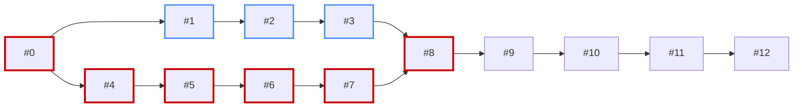

# Q-toolkit-demo

[](https://github.com/MardokHPC/Q-toolkit-demo/actions/workflows/ci.yml)


**One workload, four tools, one report that rebuilds itself without a GPU.** A workload is captured into
a `cudaGraph_t`; [graph-lint](https://github.com/MardokHPC/graph-lint) reads the topology,
[cuda-timer](https://github.com/MardokHPC/cuda-timer) times one node at a time,
[poolkit](https://github.com/MardokHPC/poolkit) turns the workload's requests into a trace and sizes a
pool, [ulpgrad](https://github.com/MardokHPC/ulpgrad) is the math inside the kernels. Every number lands
in `artifacts/report.json`; `qtoolkit_verify` rebuilds the structural ones from the committed files on a
machine with no card, and checks the arithmetic behind the measured ones.



Thirteen kernels: one stem, two branches, one join, one tail. The red branch decides the depth —
`1 + 4 + 5 = 10` — while the blue branch finishes early and frees a slot. The five-node tail is on the
critical path too, but it is serial by construction: there is nothing to choose there, which is why it
is not red. Drawn from the 13 edges in the committed [`artifacts/graph.json`](artifacts/graph.json).
`graphlint_report --format mermaid` prints the same topology with the linear runs collapsed into single
boxes ([`docs/graph-clean.mmd`](docs/graph-clean.mmd)), which is the only readable form once a graph has
five thousand nodes.

## The same work, captured the lazy way

Put an event on every node between two streams and the kernels do not change — the shape does:

| | `graph.json` | `graph.pingpong.json` |
|---|---:|---:|
| nodes | 13 | 13 |
| edges | 13 | **23** |
| depth | 10 | **13** |
| widest level | 2 | 1 |
| edges implied by a longer path | **0** | **11** |

> 11 of 23 edges are implied by a longer path; the minimal DAG has 12 edges

That is graph-lint's `redundant-edge` finding, verbatim from `artifacts/report.json`. The dashed edges
in [`docs/graph-pingpong.mmd`](docs/graph-pingpong.mmd) are the ones a longer path already implies: they
cost instantiate time and buy no ordering. Without the second shape the demo would claim a linter that
never finds anything.

## What the shape costs

Counting edges says what is wrong. It does not say what it costs. The pipeline measures that too, on the
two graphs, with the ablation's own protocol: one `cudaGraphExec_t` per shape, 10 warm-up runs and 100
measured ones for the launch, 50 instantiations for the exec.

| | `graph.json` | `graph.pingpong.json` | delta |
|---|---:|---:|---:|
| instantiate, median of 50 | 21,700 ns | 30,800 ns | **+9,100 ns** |
| launch, median of 100 | 404,304 ns | 414,496 ns | **+10,192 ns** |

**The pingpong shape costs 10,192 ns more per launch and 9,100 ns more to instantiate**, and graph-lint
names the eleven edges a longer path already implies and the three levels they add.

Both shapes are launched inside one loop, alternating which one goes first. Two separate sweeps measure
the card twice: in the runs that produced an earlier draft of this table, the clean-then-pingpong order
and the pingpong-then-clean order disagreed in sign. Interleaved, consecutive runs reproduce the same
delta, and that is the only reason the number is worth quoting.

The size of that number is the finding, not a disappointment. The clean graph's critical path is
342,880 ns of node weight, its thirteen nodes add up to 431,632 ns, and it launches in 404,304 ns: the
two branches never ran at the same time, because a 4 MiB kernel already fills this card. The work the
clean shape overlaps on paper is `sum_ns − path_ns`, and it is not saved on the device, so what the
pingpong pays is dependency overhead and one more instantiation — not lost overlap. On a workload with
headroom the same three levels would cost the sum. The pipeline is how you find out which case you are
in instead of assuming one.

The launch's `min` and `max` travel with the median in `report.json`. Here the pingpong's hundred runs
include one sample near 720,000 ns against a median of 414,496: the median is the number, the max is the
machine, and a reader who cannot see both cannot tell which one they are looking at.

## What each tool contributes

| | here it is | the number it produced |
|---|---|---|
| **graph-lint** | reads both captured graphs as files, computes levels, width, transitive reduction and the linter's findings | depth **10 vs 13**, **11** redundant edges, minimal DAG **12** |
| **cuda-timer** | one `cudaGraphExec_t` for the sweep; node *i* enabled alone, 10 warm-up + 100 measured runs; then both shapes interleaved in one launch loop | zero point **13,248 ns**, weighted critical path **342,880 ns**, 0 of 13 nodes clamped; the pingpong **+10,192 ns** per launch, **+9,100 ns** to instantiate |
| **poolkit** | the workload writes its `allocate`/`free` requests as a trace; `poolkit_advise` sizes a pool for it | 14 requests → **14 chunks**, peak **58,720,256 B (56 MiB)**, 36 classes |
| **ulpgrad** | `silu` and `exp2` inside the kernels, no vendor math | the workload's arithmetic, declared in ULP |

The four are pinned, never vendored: `cuda-timer v1.2.2`, `poolkit v1.0.0`, `ulpgrad v0.1.0`,
`graph-lint v0.3.1`, in [`cmake/pins.cmake`](cmake/pins.cmake) and nowhere else.

## Run it

The host profile needs no toolkit, no `nvcc` and no GPU. It rebuilds every structural number from the
committed artifacts and refuses the report if a single one disagrees:

```bash
cmake -S . -B build -DCMAKE_BUILD_TYPE=Release -DQTOOLKIT_DEMO_WITH_CUDA=OFF
cmake --build build
ctest --test-dir build -R qtoolkit --output-on-failure     # 7 tests
./build/qtoolkit_verify artifacts/report.json              # exit 0
```

The device profile needs CUDA 12.6 and a GPU. It runs the pipeline and rewrites `artifacts/`:

```bat
build-host.bat      rem configure, build, ctest — profile OFF
build-device.bat    rem configure, build, run the pipeline — profile ON
```

The release archive is the shortcut for the first case: `qtoolkit_verify-<version>-<platform>.zip` (or
`.tar.gz`) holds the binary, `pins.cmake` and the committed artifacts, so checking a report needs no
CMake, no compiler and no toolkit. Unpack it and run `qtoolkit_verify artifacts/report.json`.

Fetching the four libraries also registers their own ctest entries (poolkit adds eight); `-R qtoolkit`
selects the seven that belong to this repository.

## What the verifier checks

`qtoolkit_verify` reads `report.json` and rebuilds it from the other committed files, with no toolkit
linked and no GPU touched:

1. both graphs, reopened with `parse_graph` and `topology`, against `report.graph.{clean,pingpong}`;
2. `weights.json`, bound to `graph.json` by fingerprint, with the critical path recomputed;
3. `trace.jsonl`, replayed on the simulated backend with the advisor's own table;
4. the arithmetic: every weight equals `max(0, median − zero_point)`, `clamped` equals the number of zeros, and `sum_ns` equals the sum of the table;
5. the four pins against `cmake/pins.cmake` — or the copy beside the binary, when run from the release archive;
6. the shape's price: both medians and both deltas, each delta equal to its own subtraction, the launch timed on the ablation's protocol, and each median inside its own `[min, max]`.

Exit `0` means every comparison held. `1` names the comparison that failed, with both values. `2` means
it cannot decide — a missing artifact, or pins that disagree with the file — because a verifier that
answers without being able to look is worse than one that says so.

## Why

NVIDIA's official tools — Nsight Systems and Nsight Compute — provide deep, visual profiling that goes
far beyond what this pipeline attempts to measure. However, interactive GUI profilers are built for
human inspection during optimization, not for automated regressions in CI.

These four tools are designed specifically for headless automation and deterministic verification:

- **Machine-readable by default.** Instead of parsing proprietary report formats or manually inspecting
  timelines, every stage outputs plain, diffable JSON and JSONL artifacts that live directly in version
  control.
- **CI-friendly verification.** While profiling requires target hardware, structural invariants (graph
  topology, redundant edges, pool sizing, and timing arithmetic) can be re-verified on a standard
  CPU-only runner via `qtoolkit_verify` on every pull request.
- **Fail-fast regressions.** By turning profiling data into strict assertions, topology bloat or memory
  spikes break the build automatically — catching performance and structural regressions before they
  require a manual profiling session.

## Limits

- **One card, one run.** RTX 2060 SUPER, sm_75, CUDA runtime 12.6 — recorded in `report.json` next to the
  numbers. Re-running moves `weights.json` and the report's `weights` block; the graph blocks and the
  trace stay byte-identical.
- **The weighted path is a lower bound.** Subtracting the zero point is not calibrating the timer: the
  floor with one node enabled is not the floor with all of them disabled. `weights.json` says so, and the
  clamp count is printed.
- **The two peaks agreeing is not a proof.** `advise.peak_sim_bytes` and `pool_measured.high_water_mark_bytes`
  both read 56 MiB here because all 14 buffers are live at once: that is the workload's live set, not a
  validation of the replay. The report keeps the two names apart so nobody reads an equality as a check.
- **The shape's price belongs to this workload.** The eleven redundant edges cost 10,192 ns per launch
  here because every kernel already fills the card: there was no overlap to lose. On a graph of small
  kernels the same three levels would cost the sum. The measurement is a fact about this workload, not a
  price list for topologies.
- **CI has no GPU.** The device profile is compiled and not run; the seven host tests are what a pull
  request proves.

## Repository structure

```
artifacts/   the five hand-offs and report.json — committed, diffable, one owner per number
demo/        the pipeline stages: workload, capture, graph, ablation, shape cost, trace, advise, report
verify/      qtoolkit_verify — the six comparisons, no CUDA linked
tests/       the seven host tests, including the tamper cases
cmake/       pins.cmake — the four tags
docs/        pipeline.md, the two Mermaid graphs
```

The reasoning behind each boundary — which format, which owner, what the number does not prove — is in
[`docs/pipeline.md`](docs/pipeline.md).

## License

MIT, see [`LICENSE`](LICENSE).
