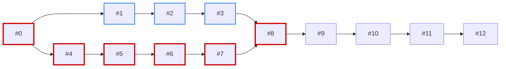

# Q-toolkit-demo

[](https://github.com/MardokHPC/Q-toolkit-demo/actions/workflows/ci.yml)


**One workload, four tools, one report that rebuilds itself without a GPU.** A workload is captured into
a `cudaGraph_t`; [graph-lint](https://github.com/MardokHPC/graph-lint) reads the topology,
[cuda-timer](https://github.com/MardokHPC/cuda-timer) times one node at a time,
[poolkit](https://github.com/MardokHPC/poolkit) turns the workload's requests into a trace and sizes a
pool, [ulpgrad](https://github.com/MardokHPC/ulpgrad) is the math inside the kernels. Every number lands
in `artifacts/report.json`, and `qtoolkit_verify` rebuilds it from the committed files on a machine with
no card.



Thirteen kernels: one stem, two branches, one join, one tail. The red branch is the one that decides the
depth — `1 + 4 + 5 = 10` — while the blue branch finishes early and frees a slot; the tail is serial
because each step reads the previous output. Drawn from the 13 edges in the committed
[`artifacts/graph.json`](artifacts/graph.json). `graphlint_report --format mermaid` prints the same
topology with the linear runs collapsed into single boxes ([`docs/graph-clean.mmd`](docs/graph-clean.mmd)),
which is the only readable form once a graph has five thousand nodes.

## The same work, captured the lazy way

Put an event on every node between two streams and the kernels do not change — the shape does:

| | `graph.json` | `graph.pingpong.json` |
|---|---:|---:|
| nodes | 13 | 13 |
| edges | 13 | **23** |
| depth | 10 | **13** |
| widest level | 2 | 1 |
| edges implied by a longer path | **0** | **11** |

> 11 of 23 edges are implied by a longer path; the minimal DAG has 12 edges

That is graph-lint's `redundant-edge` finding, verbatim from `artifacts/report.json`. The dashed edges
in [`docs/graph-pingpong.mmd`](docs/graph-pingpong.mmd) are the ones a longer path already implies: they
cost instantiate time and buy no ordering. Without the second shape the demo would claim a linter that
never finds anything.

## What each tool contributes

| | here it is | the number it produced |
|---|---|---|
| **graph-lint** | reads both captured graphs as files, computes levels, width, transitive reduction and the linter's findings | depth **10 vs 13**, **11** redundant edges, minimal DAG **12** |
| **cuda-timer** | one `cudaGraphExec_t` for the sweep; node *i* enabled alone, 10 warm-up + 100 measured runs | zero point **12,864 ns**, weighted critical path **349,808 ns**, 0 of 13 nodes clamped |
| **poolkit** | the workload writes its `allocate`/`free` requests as a trace; `poolkit_advise` sizes a pool for it | 14 requests → **14 chunks**, peak **58,720,256 B (56 MiB)**, 36 classes |
| **ulpgrad** | `silu` and `exp2` inside the kernels, no vendor math | the workload's arithmetic, declared in ULP |

The four are pinned, never vendored: `cuda-timer v1.2.2`, `poolkit v1.0.0`, `ulpgrad v0.1.0`,
`graph-lint v0.3.1`, in [`cmake/pins.cmake`](cmake/pins.cmake) and nowhere else.

## Run it

The host profile needs no toolkit, no `nvcc` and no GPU. It rebuilds every structural number from the
committed artifacts and refuses the report if a single one disagrees:

```bash
cmake -S . -B build -DCMAKE_BUILD_TYPE=Release -DQTOOLKIT_DEMO_WITH_CUDA=OFF
cmake --build build
ctest --test-dir build -R qtoolkit --output-on-failure     # 7 tests
./build/qtoolkit_verify artifacts/report.json              # exit 0
```

The device profile needs CUDA 12.6 and a GPU. It runs the pipeline and rewrites `artifacts/`:

```bat
build-host.bat      rem configure, build, ctest — profile OFF
build-device.bat    rem configure, build, run the pipeline — profile ON
```

Fetching the four libraries also registers their own ctest entries (poolkit adds eight); `-R qtoolkit`
selects the seven that belong to this repository.

## What the verifier checks

`qtoolkit_verify` reads `report.json` and rebuilds it from the other committed files, with no toolkit
linked and no GPU touched:

1. both graphs, reopened with `parse_graph` and `topology`, against `report.graph.{clean,pingpong}`;
2. `weights.json`, bound to `graph.json` by fingerprint, with the critical path recomputed;
3. `trace.jsonl`, replayed on the simulated backend with the advisor's own table;
4. the arithmetic: every weight equals `max(0, median − zero_point)`, and `clamped` equals the number of zeros;
5. the four pins against `cmake/pins.cmake`.

Exit `0` means every comparison held. `1` names the comparison that failed, with both values. `2` means
it cannot decide — a missing artifact, or pins that disagree with the file — because a verifier that
answers without being able to look is worse than one that says so.

## What it is not

Not a fifth tool, not a wrapper: the four formats stay visible as files you can open. Not a benchmark of
the four — it composes them. It replaces an afternoon of running four terminals by hand with one command
and one diffable file.

## Limits

- **One card, one run.** RTX 2060 SUPER, sm_75, CUDA runtime 12.6 — recorded in `report.json` next to the
  numbers. Re-running moves `weights.json` and the report's `weights` block; the graph blocks and the
  trace stay byte-identical.
- **The weighted path is a lower bound.** Subtracting the zero point is not calibrating the timer: the
  floor with one node enabled is not the floor with all of them disabled. `weights.json` says so, and the
  clamp count is printed.
- **The two peaks agreeing is not a proof.** `advise.peak_sim_bytes` and `pool_measured.high_water_mark_bytes`
  both read 56 MiB here because all 14 buffers are live at once: that is the workload's live set, not a
  validation of the replay. The report keeps the two names apart so nobody reads an equality as a check.
- **CI has no GPU.** The device profile is compiled and not run; the seven host tests are what a pull
  request proves.

## Repository structure

```
artifacts/   the five hand-offs and report.json — committed, diffable, one owner per number
demo/        the pipeline stages: workload, capture, graph, ablation, trace, advise, report
verify/      qtoolkit_verify — the five comparisons, no CUDA linked
tests/       the seven host tests, including the tamper cases
cmake/       pins.cmake — the four tags
docs/        pipeline.md, the two Mermaid graphs
```

The reasoning behind each boundary — which format, which owner, what the number does not prove — is in
[`docs/pipeline.md`](docs/pipeline.md).

## License

MIT, see [`LICENSE`](LICENSE).
